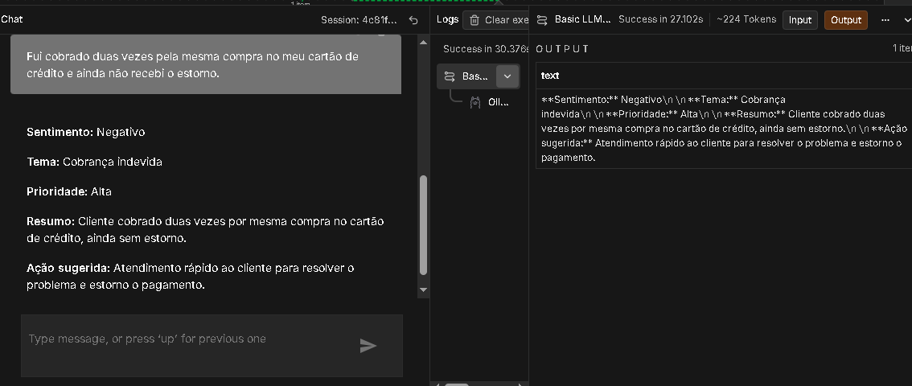

# CardFeedback AI

## Sobre o projeto
O CardFeedback AI é um protótipo de assistente virtual com inteligência artificial para analisar feedbacks de clientes sobre cartões de crédito.

O objetivo é identificar sentimentos, classificar os principais problemas e sugerir ações para a equipe responsável.

## Tecnologias utilizadas
- n8n para automação do fluxo.
- Docker para executar o n8n localmente.
- Ollama para executar o modelo de IA localmente.
- Qwen2.5 1.5B como modelo utilizado nos testes.

## Como funciona
O usuário envia uma mensagem sobre um problema relacionado ao cartão de crédito. O assistente retorna:
- Sentimento: positivo, negativo ou neutro.
- Tema: categoria do problema.
- Prioridade: alta, média ou baixa.
- Resumo: descrição breve do feedback.
- Ação sugerida: orientação para a equipe responsável.

## Testes realizados
Foram testadas mensagens sobre cartão bloqueado, cobrança duplicada e indisponibilidade do aplicativo.

O protótipo conseguiu produzir respostas curtas com sentimento, tema, prioridade, resumo e ação sugerida.

## Limitações identificadas
Durante os testes, o modelo apresentou alguns erros ao classificar temas e, ocasionalmente, incluiu categorias ou informações que não estavam claramente presentes na mensagem original.

Por isso, o protótipo ainda precisa de melhorias antes de ser utilizado em situações reais.

## Melhorias futuras
- Aumentar a precisão da classificação dos feedbacks.
- Evitar categorias sem evidências no texto.
- Comparar os resultados com dados de referência.
- Automatizar a análise de vários feedbacks.
- Gerar relatórios sobre os principais problemas relatados pelos clientes.

## Conclusão
O CardFeedback AI demonstra como ferramentas de automação e inteligência artificial podem apoiar a análise de feedbacks de clientes. O projeto constitui um protótipo funcional para fins de aprendizado e demonstração.

## Evidência do protótipo em funcionamento

A imagem abaixo registra um teste do CardFeedback AI no n8n, demonstrando a análise de um feedback de cliente sobre cartão de crédito.

